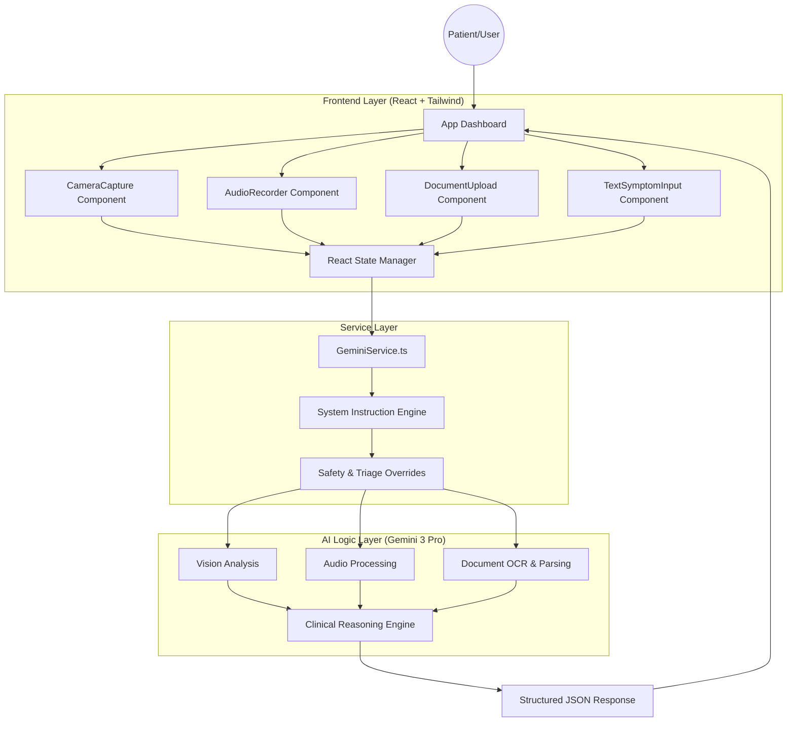

# MEDI-SENSE: Multimodal AI Medical Evaluator

**MEDI-SENSE** is an advanced, AI-powered medical triage system designed to analyze patient health through multiple modalities: visual facial cues, vocal symptom descriptions, free-form text, and medical document uploads.

Powered by **Google Gemini 3 Pro**, it utilizes chain-of-thought reasoning, standard clinical frameworks (OLDCARTS, VINDICATE), and strict safety protocols to provide early triage insights and structured clinical summaries.

---

## 🏗️ System Architecture

MEDI-SENSE is built as a single-page React application that acts as an orchestrator between patient data inputs and the Gemini Multimodal API.



---

## 🚀 Key Features

### 1. Multimodal Data Fusion
MEDI-SENSE does not analyze inputs in isolation. It correlates data across channels:
*   **Visual**: Detects pallor, jaundice, ptosis, fatigue, and rashes.
*   **Audio**: Analyzes tone, breathing patterns (stridor/wheezing), and extracts spoken symptoms.
*   **Text**: Parses specific symptom details and timeline.
*   **Documents**: OCRs and interprets labs, prescriptions, and reports (PDF/Images).

### 2. Clinical Reasoning Engine
The AI is prompted to strictly follow medical education frameworks:
*   **Symptom History**: Uses **OLDCARTS** (Onset, Location, Duration, Character, Aggravators, Relievers, Timing, Severity) and **OPQRST**.
*   **Differential Diagnosis**: Uses **VINDICATE** (Vascular, Infectious, Neoplastic, Degenerative, Iatrogenic, Congenital, Autoimmune, Trauma, Endocrine) to broaden the logic chain.
*   **Risk Scoring**: Qualitatively applies criteria from **NEWS2**, **qSOFA**, and **Wells Criteria**.

### 3. Safety & Consistency Protocols
*   **Rule-Based Overrides**: Hard-coded logic forces "HIGH" or "CRITICAL" severity if keywords like "Chest Pain radiating to arm," "Syncope," or "Sudden vision loss" are detected.
*   **Consistency Checker**: A mandatory "second pass" where the AI verifies its own conclusions against the evidence to prevent hallucinations and ensure text/voice/face data align.

### 4. PDF Report Generation
*   Download a comprehensive, printable PDF summary of the entire analysis for offline review or clinical handoff.

---

## 🧠 The Reasoning Pipeline

When a user clicks **"Generate Final Report"**, the data flows through the following pipeline:

1.  **Data Aggregation**: Images are converted to Base64, Audio to Blob, and Text is normalized.
2.  **Context Construction**: A complex System Instruction is assembled, injecting:
    *   The Persona (Medical Triage Assistant).
    *   The Output Schema (Strict JSON).
    *   The Framework Rules (OLDCARTS, etc.).
    *   The Safety Overrides.
3.  **Multimodal Inference**: Gemini 3 Pro processes video frames, audio waves, and text simultaneously.
4.  **Self-Correction**: The model runs an internal validation step to ensure the severity score matches identified red flags.
5.  **Structured Output**: Returns a JSON object containing specific analysis for every modality plus a synthesized "Doctor Ready Summary."

---

## 📦 Installation & Setup

### Prerequisites
*   Node.js (v18+)
*   Google AI Studio API Key (with access to Gemini 1.5 Pro or Gemini 3 Pro)

### Steps

1.  **Clone the Repository**
    ```bash
    git clone https://github.com/yourusername/medi-sense.git
    cd medi-sense
    ```

2.  **Install Dependencies**
    ```bash
    npm install
    ```

3.  **Configure API Key**
    Create a `.env` file in the root directory:
    ```env
    API_KEY=your_google_gemini_api_key_here
    ```
    *Note: Ensure your build system (e.g., Vite/Webpack) is configured to expose this variable, or use `REACT_APP_API_KEY` depending on your bundler.*

4.  **Run Development Server**
    ```bash
    npm start
    ```

---

## 🩺 Medical Disclaimer

**MEDI-SENSE IS NOT A DOCTOR.**

*   This system is for **demonstration and triage support purposes only**.
*   It does **not** provide official medical diagnoses.
*   It is designed to identify *patterns* and *risk levels* to assist clinical workflow, not replace it.
*   **Always call emergency services** in the event of a medical emergency.

---

## 📂 Project Structure

```
/
├── public/              # Static assets
├── src/
│   ├── components/
│   │   ├── AnalysisResult.tsx    # Renders the JSON output (Report Board)
│   │   ├── AudioRecorder.tsx     # Mic handling & visualization
│   │   ├── CameraCapture.tsx     # Webcam stream & Viewfinder
│   │   ├── DocumentUpload.tsx    # Batch file handling
│   │   └── TextSymptomInput.tsx  # Free-text input
│   ├── services/
│   │   └── geminiService.ts      # API Logic, System Prompts, Schema
│   ├── App.tsx          # Main Layout & State Management
│   ├── index.tsx        # Entry Point
│   └── types.ts         # TypeScript Interfaces for API Response
├── .env                 # API Key configuration
├── package.json         # Dependencies
└── README.md            # Documentation
```

## 🛠️ Tech Stack

*   **Frontend**: React 19
*   **Styling**: Tailwind CSS
*   **Icons**: Lucide React
*   **AI Model**: Google Gemini 3 Pro (via `@google/genai` SDK)
*   **PDF Generation**: jsPDF, html2canvas
*   **Build Tool**: Parcel / Vite (implied)

---

## 🔮 Future Roadmap

*   [ ] Integration with wearable health API (Apple Health / Google Fit).
*   [ ] Multi-language support for non-English speakers.
*   [ ] Local model fallback (Gemini Nano) for offline basic triage.
*   [x] PDF Report generation (downloadable output).